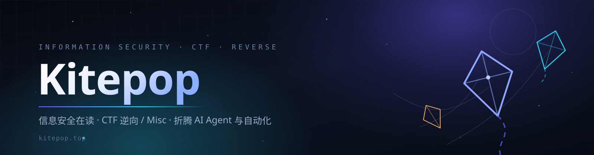

  

<i>SOS 团精神：先把不可能的事做了，再解释原理。</i>

  
  
  

---

## 关于

- 🎓 信息安全专业在读，日常在学校、靶场和终端之间来回横跳。
- 🔍 **CTF 逆向 / Misc**：VM 保护题、动态调试、文件格式与协议逆向、杂项解谜。
- 🛠 喜欢把重复劳动交出去：Python 工具链、爬虫、AI Agent、MCP 插件。
- ✍️ 踩过的坑都写进 [Kitepop](https://kitepop.top/) —— 30+ 篇，还在更。
- 🌸 凉宫春日爱好者；相信好奇心是最省力的生产力。

> **现在在折腾：** 把在用的 Hexo 博客拆了重写（React + Vite + Hono）、给 AI 客户端写 MCP 工具、以及在 root 安卓上跑各种自动化实验。

## 技术栈

  
  
  
  
  
  

| 方向  | 常用工具 |
| --- | --- |
| **逆向分析** | IDA Pro · Ghidra · x64dbg · Frida · PE/ELF 结构与脱壳 · 动态调试 |
| **Web / 渗透** | Burp Suite · Wireshark · Nmap · sqlmap · XXE / 反序列化 / 逻辑漏洞复现 |
| **开发** | React · Vite · Hono · SQLite · Node.js · Go |
| **基础设施** | Linux · Docker · Nginx · MySQL · Git |

## 精选项目

| 项目  | 说明  | 技术  |
| --- | --- | --- |
| [**Kitepopblog**](https://github.com/qingxia5201314/Kitepopblog) | 自研博客系统：React 前端 + Hono 后端，自带管理后台、鉴权、评论、媒体管理与 SEO 优化笔记 | TypeScript · React · Hono |
| [**kiteblog2**](https://github.com/qingxia5201314/kiteblog2) | [kitepop.top](https://kitepop.top/) 现役博客源码（Hexo + Arknights 主题），CTF / 渗透 / 逆向札记都在这儿 | JavaScript · Hexo |
| [**REEnd**](https://github.com/qingxia5201314/REEnd) | 逆向与后端自学资料库：Linux、MySQL、Python 的笔记与练习 | 笔记 / 练习 |
| [**-MCP**](https://github.com/qingxia5201314/-MCP) | 给 Codex / Claude 这类 AI 客户端用的万兴脑图 MCP Server：自然语言生成与编辑思维导图，支持 Markdown / FreeMind / OPML 导出与自动备份（开发中） | MCP · Node.js |
| [**ZafxyrAgent**](https://github.com/qingxia5201314/ZafxyrAgent) | 跑在 root 安卓上的自治 AI Agent：LLM function calling 直接操作手机（fork，KernelSU / Magisk 模块 + Go 守护进程） | Go · KernelSU |

## 最近在写

| 文章  | 日期  |
| --- | --- |
| [记一次 CTF 简单动态调试](https://kitepop.top/2026/10/14/%E8%AE%B0%E4%B8%80%E6%AC%A1CTF%E7%AE%80%E5%8D%95%E5%8A%A8%E6%80%81%E8%B0%83%E8%AF%95/) | 2026-10-14 |
| [VM 逆向 CTF 研究 —— WcyVM](https://kitepop.top/2026/10/12/VM%E9%80%86%E5%90%91CTF%E7%A0%94%E7%A9%B6%E2%80%94%E2%80%94WcyVM/) | 2026-10-12 |
| [XXE 注入](https://kitepop.top/2026/10/11/XXE%E6%B3%A8%E5%85%A5/) | 2026-10-11 |
| [关于使用 liveagent 和 pi-desktop 有感](https://kitepop.top/2026/10/10/%E5%85%B3%E4%BA%8E%E4%BD%BF%E7%94%A8liveagent%E5%92%8Cpi-desktop%E6%9C%89%E6%84%9F/) | 2026-10-10 |

<a href="https://kitepop.top/archives/">全部文章 →</a>

## GitHub

  

持续输出比一次性爆发更难，也更值钱。

## 联系

- 博客留言：[kitepop.top](https://kitepop.top/)
- 提 Issue / PR：任意仓库都行，看到会回
- 邮件：[dongjiapeng520@gmail.com](mailto:dongjiapeng520@gmail.com)
- 想聊 CTF 逆向、Misc、AI Agent，或者单纯来扔个 bug —— 都欢迎

Keep curious. — Kitepop

